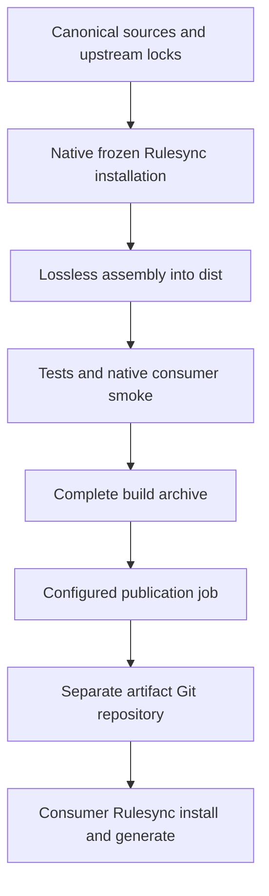

# Collection pipeline

## Ownership

`agentic-src` is the source repository. Its workflow publishes the separate, machine-managed `agentic` Git repository. GitHub publication credentials are not prerequisites for local builds or local Git publication tests.



Only this source repository contains authored content, dependency selections, build code, and contributor instructions. The artifact contains `README.md`, `provenance.json`, and `collections/<name>/rules/` and `skills/`. It does not contain upstream caches, source configs, dependency locks, agent runtime configuration, or publication credentials. Required companion licenses and attribution stay with their content.

The small assembler is necessary because Rulesync 43.6.0 has no neutral collection export. `claudecode-plugin` changes frontmatter and is not a lossless export. Rulesync still owns fetching, dependency resolution, integrity checks, locks, and consumer harness conversion. The assembler does not implement these operations.

## Build

```sh
pnpm install --frozen-lockfile
GH_TOKEN="$(gh auth token)" pnpm build
```

The build discovers every `src/*/rulesync.jsonc` collection in sorted order. It runs the installed, pinned Rulesync CLI with `install --frozen` from each collection directory, so the adjacent native lock and `.curated/` cache belong to that collection. A config path alone would not relocate native installation.

After installation, assembly copies effective canonical rules and skill directories without parsing or rewriting their content. Local rules override same-named curated rules. Local skills replace same-named curated skill directories as a whole; old upstream companions do not survive an override. The builder preserves companion bytes and executable modes, carries rule license sidecars, and does not publish the `.curated/` wrapper.

Native frozen installation does not remove every stale cached artifact. Assembly uses the locked inventory rather than copying all cached directories. Source changes must have reconciled native locks; a stale source inventory fails rather than silently publishing obsolete cached content. JSONC parsing is used for that consistency check, not for resolving upstream dependencies.

The current assembler accepts this repository's unqualified Git source lock entries. It requires source strings to match native lock keys case-insensitively and rejects ambiguous qualified keys and npm inventories instead of recreating Rulesync's resolver. Reconcile removals with native non-frozen `install`; adding a different source transport or qualified lock form requires extending and testing this inventory adapter.

Intended skill companions, including dotfiles, config examples, binary fixtures, and license files, remain unchanged. Symbolic links and explicit credential/VCS/cache stores fail the build rather than producing a silently truncated skill. Keep personal stores outside canonical source directories.

The builder stages a complete snapshot before replacing `dist/`. Failure retains the previous successful output. Successful rebuilds remove obsolete output, including removed local files and collections. Do not mix maintained files into `dist/` or its build staging paths.

`provenance.json` records its schema version, source repository, Git commit, actual dirty state, pinned Rulesync version, and sorted collection names with native lock digests. It contains no build timestamp. Identical source snapshots produce identical materialized artifact bytes. A local dirty build is valid for preview, but the publisher rejects it.

## Workflow triggers

`.github/workflows/collections.yml` builds on pull requests, pushes to `main`, version tags matching `v*`, and manual dispatch. The build job installs pinned dependencies, runs the test suite, builds all collections with frozen upstream locks, exercises the built base/testing selection through native Rulesync for OMP and Claude Code, and uploads a complete archive.

The downloadable Actions artifact is named `agentic-<source-sha>` and contains `agentic.tar.gz`. Tar preserves executable companion modes across Actions upload/download, which otherwise do not preserve those modes. This archive is a build download, not a native Rulesync install source.

Publication is a separate job and is disabled while `ARTIFACT_REPOSITORY` is unset. When configured:

| Event | Artifact effect |
| --- | --- |
| Pull request | Build and test only; never publish |
| Push to source `main` | Update artifact `main` with one complete snapshot |
| Push of a source `v*` tag | Publish the matching immutable artifact tag; do not advance artifact `main` |
| Manual dispatch with default `publish: false` | Build and test only |
| Manual dispatch with `publish: true` | Publish only when the selected ref is source `main` or a version tag |

An identical publication is a no-op. A version tag that already contains different content is an error. Tags must identify the checked-out source commit. Git history and published tags are never force-replaced. Concurrent updates are subject to ordinary Git fast-forward protection; a rejected publication fails rather than force-pushing over another snapshot. Rerun a failed eligible workflow after resolving its cause.

## Publisher

The publisher requires complete build output and clean source provenance matching its source checkout. It refuses to use the source repository as its destination. It creates its own disposable clone, accepts an empty artifact repository, and refuses to replace a nonempty unrelated repository that lacks the expected provenance ownership marker. Changes and removals are committed together as one complete artifact snapshot.

```sh
# Local proof only, using an empty disposable bare repository:
git init --bare --initial-branch=main /tmp/agentic-artifact.git
pnpm publish:artifact --repository file:///tmp/agentic-artifact.git

# A source version tag must exist and point at the built source commit:
pnpm publish:artifact --repository file:///tmp/agentic-artifact.git --tag v1.2.3
```

Local publication uses native Git without GitHub authentication. The publisher does not alter source remotes or commit source changes. The workflow invokes the same publisher, using an `owner/repository` target and an ephemeral `ARTIFACT_TOKEN`. GitHub publication is not part of local verification and requires separate approval.

## GitHub integration

1. The source repository is `asmundwien/agentic-src`; source clone remotes and integrations must use that name. Reusing the old name disables GitHub's rename redirect; do not rely on it.
2. The artifact repository is `asmundwien/agentic`. Its initial publication must start from an empty repository. Do not initialize unrelated content there or maintain files there by hand.
3. Create/install a GitHub App on the artifact repository with Contents read/write permission. Keep the installation limited to that target. The source workflow's ordinary `GITHUB_TOKEN` cannot write to a different repository.
4. Configure source repository secrets `ARTIFACT_APP_ID` and `ARTIFACT_APP_PRIVATE_KEY`. Configure repository variable `ARTIFACT_REPOSITORY=asmundwien/agentic` only when publication is intended. This variable enables publication on subsequent eligible pushes.
5. Run a manual workflow from source `main` with `publish: true` for the first rolling snapshot. Verify the artifact and update consumers to artifact refs and fresh locks. Old locks referring to the original source repository's commits do not identify commits in the new artifact history.
6. Publish source version tags when releases are intended. Consumers can select the same artifact tag, or pin an artifact commit directly.

The workflow checks source/target identities before requesting its target-scoped App token. Credentials are passed through process environments, not embedded in repository URLs, generated content, or persisted Git credential files. Do not put publication secrets in pull-request jobs.

## Verification

`pnpm test` uses real temporary files and Git repositories. It covers canonical metadata preservation, companions and modes, override precedence, stale output/cache exclusion, failed-build preservation, publication ownership, no-op updates, immutable tags, and native Rulesync installation/generation/removal in isolated consumers. The consumer integration includes explicit global generation and a second target.

Local end-to-end proof must also run the real complete build on the repository's collection selection, publish a clean disposable source snapshot into a local bare artifact repository, and consume that published tree with the pinned CLI. OMP discovery can be checked locally without sending a model request. Do not infer GitHub execution, App installation, remote permissions, or hosted runner behavior from local checks; those remain the later integration check.

### Local proof exercised

The implementation was exercised on macOS arm64 before GitHub integration:

| Check | Observed result |
| --- | --- |
| Regression suite | All 37 tests passed on Node 22.22.0 and Node 26.8.1 |
| Complete source build | All 13 collections produced 32 skills and 2 canonical rules |
| Clean-checkout upstream installation | Native frozen installs fetched every collection without preinstalled curated inputs; the source checkout remained clean |
| Repeatability | Warm, repeated, and cache-free builds had identical artifact bytes and executable bits |
| Actions archive boundary | Tar packing/restoration preserved artifact bytes and executable bits |
| Local Git publication | Initial main publication, identical no-op publication, and a release tag without advancing main succeeded |
| Native consumers | Published local Git content installed and passed frozen installation, then generated for OMP and Claude Code |
| Global scope | Explicit global preview/generation succeeded with isolated HOME/XDG directories |
| OMP runtime | OMP 18.16.0 RPC state contained selected rule text and upstream/local skills in both project and global scope, without submitting an inference prompt |
| Collection removal | Removing testing removed its project outputs from both targets and its global OMP outputs, retaining the remaining selection |
| Workflow validation | actionlint 1.7.12 accepted the workflow |

OMP RPC inspection selected a model explicitly with `--model openai/gpt-4o-mini`; it did not require a provider credential or send a model request. Native generation emits a no-root-rule warning for the current non-root base rules. Their actual OMP activation was verified rather than changing rule semantics to suppress the warning.

No hosted workflow, GitHub App authentication, cross-repository GitHub push, repository rename, or real-home agent installation was exercised. The source working repository was not committed or pushed; clean source commits and artifact publication existed only in disposable local repositories.
